<p align="center">
  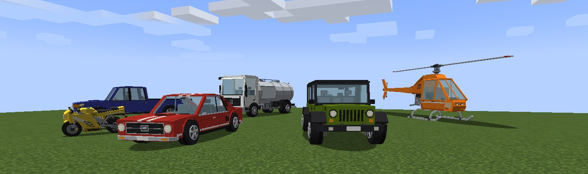
</p>

<h1 align="center">
  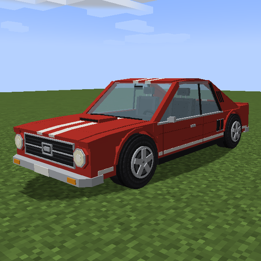<br>
  Overthought Vehicles
</h1>

<p align="center">
Vehicles thought through to the last bolt: cars, bikes, boats and planes, a fuel line from well to pump,<br>
and a garage where every part wears, fails and gets fixed.
</p>

<p align="center">
  
  
  
  <a href="https://github.com/Trossty/overthought-vehicles/wiki"></a>
</p>

<p align="center">
  <a href="https://github.com/Trossty/overthought-vehicles/wiki/Getting-Started"><b>Getting started</b></a> ·
  <a href="https://github.com/Trossty/overthought-vehicles/wiki/Vehicles"><b>Vehicles</b></a> ·
  <a href="https://github.com/Trossty/overthought-vehicles/wiki/Workshop"><b>Workshop</b></a> ·
  <a href="https://github.com/Trossty/overthought-vehicles/wiki/Fuel"><b>Fuel</b></a> ·
  <a href="https://github.com/Trossty/overthought-vehicles/issues/new/choose"><b>Report a bug</b></a>
</p>

---

## 19 vehicles to drive, sail and fly

<table>
  <tr>
    <td align="center">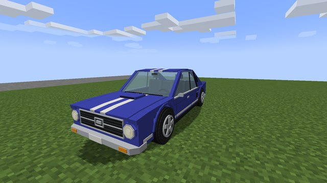<br><sub><b>Muscle car</b></sub></td>
    <td align="center">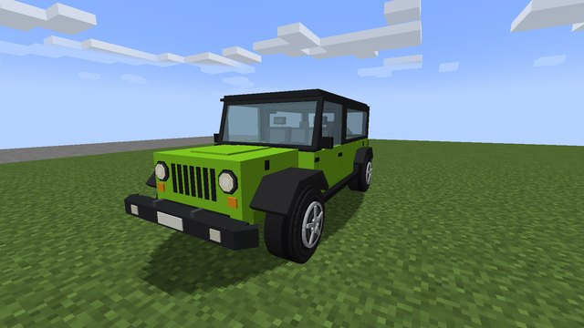<br><sub><b>Off-roader</b></sub></td>
    <td align="center">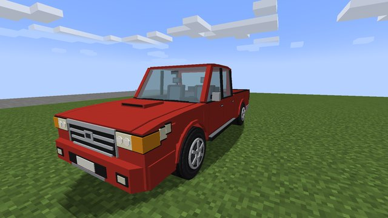<br><sub><b>Pickup truck</b></sub></td>
  </tr>
  <tr>
    <td align="center">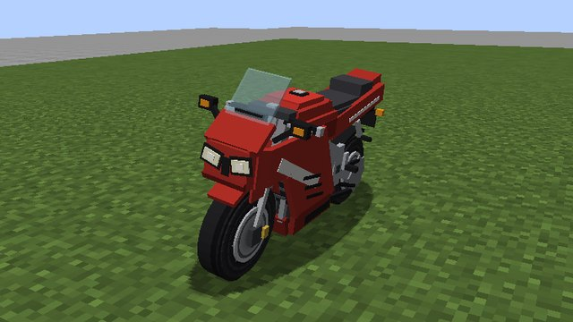<br><sub><b>Sport bike</b></sub></td>
    <td align="center">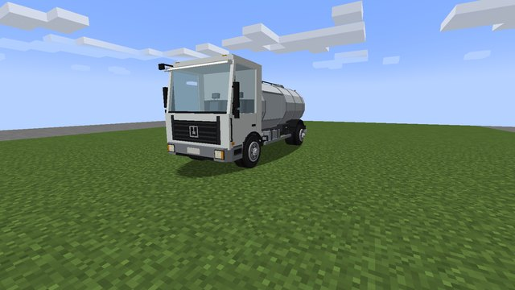<br><sub><b>Tanker truck</b></sub></td>
    <td align="center">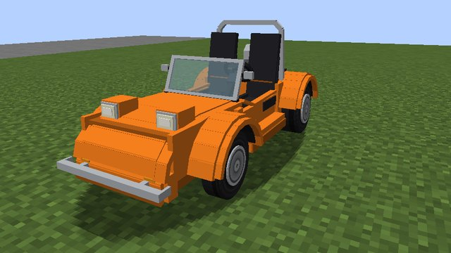<br><sub><b>Dune buggy</b></sub></td>
  </tr>
  <tr>
    <td align="center">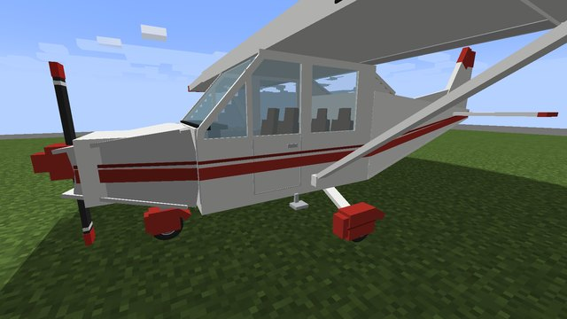<br><sub><b>Light aircraft</b></sub></td>
    <td align="center">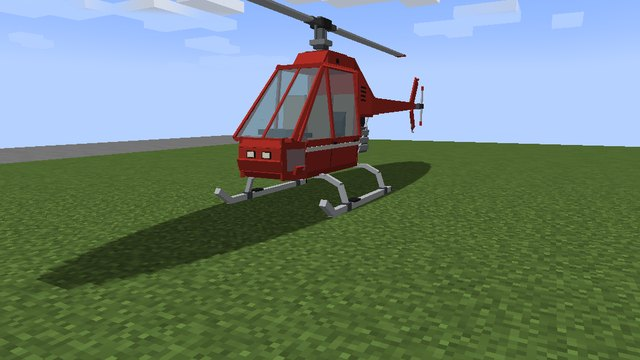<br><sub><b>Helicopter</b></sub></td>
    <td align="center">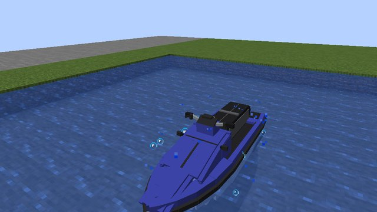<br><sub><b>Water scooter</b></sub></td>
  </tr>
</table>

Sedans, a classic sedan, a tow truck, a scooter, a quad, a go-kart, a golf cart, a bowrider, a tractor and a lawn tractor too, plus box and flatbed trailers, a caravan, tow dollies, a seed drill and a fertilizer spreader. Every one is built from boxes with real proportions and round wheels. **[See them all →](https://github.com/Trossty/overthought-vehicles/wiki/Vehicles)**

## A garage that works like a real one

<table>
  <tr>
    <td width="50%">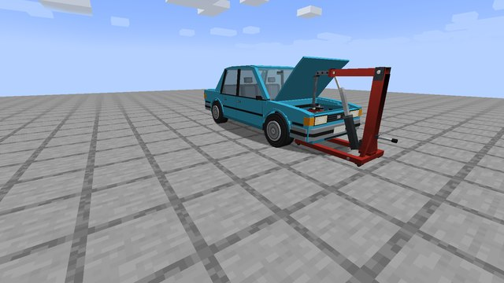</td>
    <td width="50%">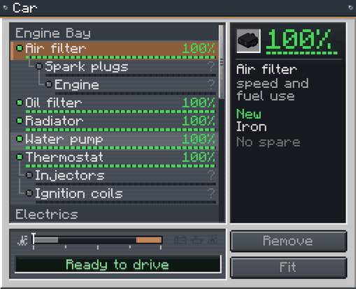</td>
  </tr>
</table>

- **24 parts per vehicle** that wear as you drive and come off in order: brake pads sit behind the wheel, the clutch behind the gearbox.
- Every worn part shows itself on the road: misfires, soft brakes, a car that pulls to one side or overheats.
- Raise it on the **lift**, pull the engine with the **hoist**, strip it on the **stand** down to pistons, valves and crankshaft.
- Find the fault with an **OBD tablet**, a **compression tester** and a **dynamometer**, then fit economy, standard or performance parts.
- Crashes dent the side that took the hit, can puncture the tank and hurt the people inside.

**[Workshop guide →](https://github.com/Trossty/overthought-vehicles/wiki/Workshop)**

## Fuel from the ground up

<table>
  <tr>
    <td width="50%">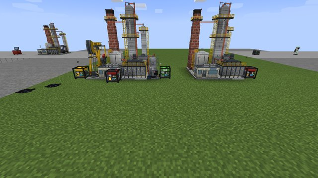</td>
    <td width="50%">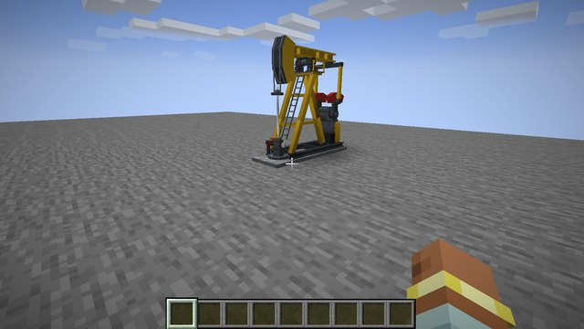</td>
  </tr>
</table>

Find oil with a survey kit, pump it with a **pumpjack**, crack it in a **refinery**, clean diesel in a **hydrotreater**, then pipe it to tanks and a **fuel pump** with a hose. Raw fuel straight from the refinery wears the engine, and every fuel is a real fluid other mods' pipes can carry.

**[Fuel guide →](https://github.com/Trossty/overthought-vehicles/wiki/Fuel)**

## Power, roads and electric cars

<table>
  <tr>
    <td width="50%">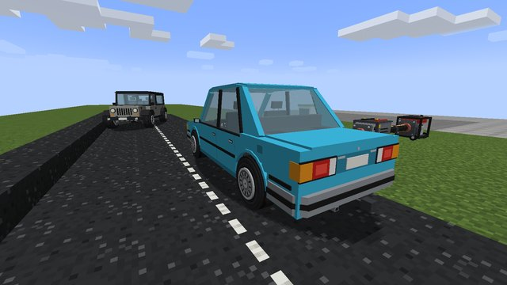</td>
    <td width="50%">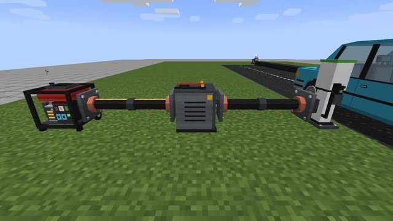</td>
  </tr>
</table>

Coal, diesel and biofuel generators, cables, a battery bank and a **charging post** for electric vehicles. Lay **asphalt** in layers and paint lanes, arrows and crossings on it.

**[Power and roads →](https://github.com/Trossty/overthought-vehicles/wiki/Power-and-Roads)**

## Controls

| Key | Car | Plane | Helicopter |
|-----|-----|-------|------------|
| W / S | Throttle / brake and reverse | Throttle / dive | Tilt forward / back |
| A / D | Steer | Bank | Turn |
| Space | Handbrake (drift at speed) | Take off and climb | Collective (up) |
| H | Horn | | |
| Shift | Get out | Get out | Get out |

## Getting started

<table>
  <tr>
    <td width="50%">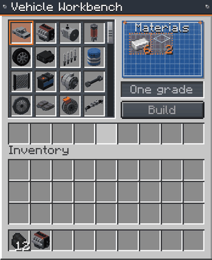</td>
    <td width="50%">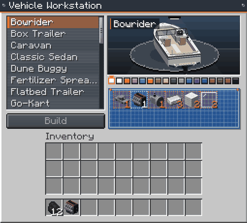</td>
  </tr>
  <tr>
    <td align="center"><sub>Build parts at the <b>Vehicle Workbench</b></sub></td>
    <td align="center"><sub>Put the vehicle together at the <b>Vehicle Workstation</b></sub></td>
  </tr>
</table>

Open the crate it comes in with a **Wrench** and cut a **Car Key** for it. The [Getting Started](https://github.com/Trossty/overthought-vehicles/wiki/Getting-Started) page has every recipe.

Also in the box: Jade and WTHIT tooltips, a datapack format where [a new vehicle is one JSON file](https://github.com/Trossty/overthought-vehicles/wiki/Adding-Vehicles), multiplayer, and English and Turkish.

## Building from source

```bash
./gradlew build                # the jar ends up in build/libs/
./gradlew runClient            # a development client
./gradlew runGameTestServer    # the game tests
```

Java 21 is needed. How the mod works inside is in the [developer notes](https://github.com/Trossty/overthought-vehicles/wiki/Developer-Notes) (Turkish); open work is in [GELISTIRME.md](GELISTIRME.md). Bugs and ideas go to the [issue tracker](https://github.com/Trossty/overthought-vehicles/issues/new/choose).

## License

[MIT](LICENSE.txt): use it, change it, build on it and share it, as long as the licence notice goes with it.
