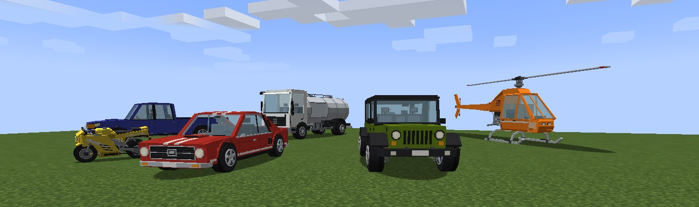
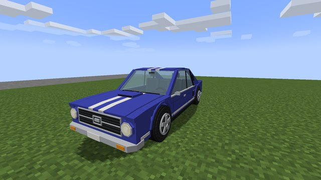
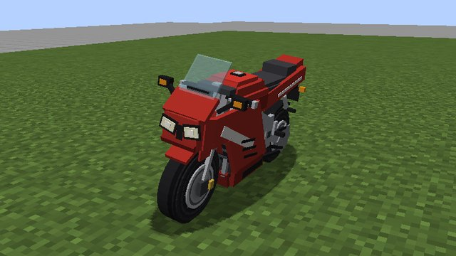
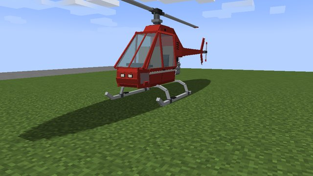
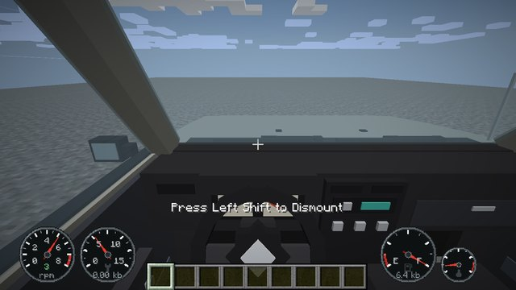
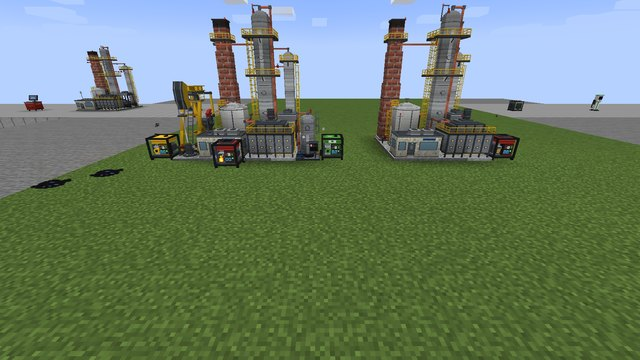
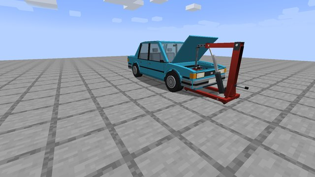
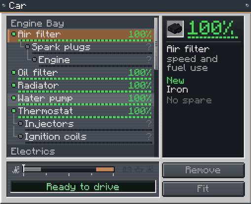
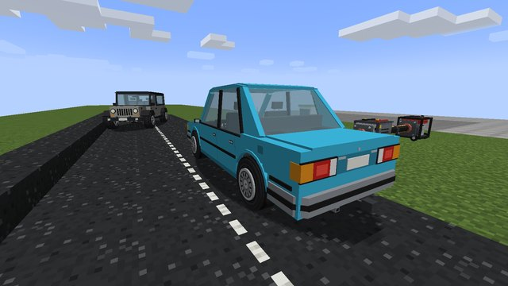

# Overthought Vehicles — store page text

Copy the sections below into the Modrinth / CurseForge page.

**Summary (one line):**
Vehicles thought through to the last bolt: cars, bikes, boats and planes, a fuel line from well to pump, and a garage where every part wears, fails and gets fixed.

---

## Overthought Vehicles

Drive, fly, sail — then pull the engine apart when it starts to cough.

Overthought Vehicles adds 19 drivable vehicles to Minecraft, plus trailers and farm implements, and the whole world around them: oil in the ground, a refinery to turn it into fuel, pumps to fill up at, and a workshop where you keep everything running. Every vehicle has real proportions, real wheels and a real fuel tank, and every one of them breaks down if you don't look after it.

### Vehicles

  

- **Cars:** Sedan, Classic Sedan, Muscle Car, Off-Roader
- **Work vehicles:** Pickup Truck (picks up items it drives over), Tanker Truck (carries any fluid), Tow Truck
- **Two wheels:** Scooter and Sport Bike — they lean into corners, and so does the rider
- **Small and fun:** Quad Bike, Go-Kart, Dune Buggy, electric Golf Cart
- **On the water:** Bowrider and Water Scooter
- **In the air:** Light Aircraft and a four-seat Helicopter that autorotates down if the engine dies
- **On the farm:** Tractor with a Seed Drill and a Fertilizer Spreader; a Lawn Tractor that mows grass and flowers into its trailer
- **Towing:** Box and flatbed trailers, a caravan, tow dollies and a wheel lift

Vehicles are built at the Vehicle Workstation: pick a model, spin the 3D preview, choose a colour and build it. It comes out in a wooden crate — set it down and open it with a wrench.

### Driving

- Throttle, brakes, reverse and speed-sensitive steering; handbrake drifts
- Engine sounds built from each engine's own firing, with a real gearbox: the note drops on every upshift — four-cylinder, six-cylinder, V8, diesel and electric all sound different
- Road feel: gravel crunches, asphalt hisses, rough ground shakes the camera
- Analog dashboard with speedometer, rev counter, gear, fuel and temperature
- Fully enclosed cabins with steering wheels, pedals and gear levers that move
- Horn, brake lights, headlights, keys and locking
- Paint any vehicle with dyes, or mix any colour with the spray can

### Fuel, from the ground up

- Oil deposits in the world, a pumpjack to draw them, a multiblock refinery and a hydrotreater to clean the fuel
- Biofuel from organic matter as a second route
- Pipes, valves and storage tanks to move it; a fuel pump with a hose that follows you
- Hold the nozzle or a jerry can to the filler cap and hold right-click to fill up
- Each vehicle has its own tank size; consumption depends on speed, throttle, slope and load
- Dirty, unrefined fuel works — but it wears out the engine and spark plugs fast

### The workshop

 

- 24 parts per vehicle wear with use and mileage; a worn part makes itself felt on the road
- A vehicle lift to raise the car and work underneath it; parts come off in the right order
- A service screen to diagnose and swap parts, in several quality grades
- An OBD tablet that shows live fault codes (worst first), fuel, body and engine temperature
- Crashes dent the body zone that took the hit, can puncture the tank and hurt the people inside; badly wrecked vehicles fall apart into scrap

### Power and roads

- Coal, biofuel and diesel generators, energy cables, a battery bank and a charging post for electric vehicles
- An electric motor option for vehicles: a battery instead of a tank
- Cables and pipes connect to other mods' cables, pipes and tanks
- Asphalt that lays down in layers like snow, and road paint for lane lines, arrows, crossings, stop lines and parking bays

### Also

- An advancement chain from your first oil well to your first stretch of asphalt
- A small config file for server owners (`config/overthought_vehicles.json`)
- Jade and WTHIT support: look at a vehicle to see its status
- Built and tested for multiplayer
- English and Turkish

### Controls

| Key | Action |
|-----|--------|
| W | Throttle |
| S | Brake / reverse |
| A / D | Steer |
| Space | Handbrake (with steering at speed: drift) |
| H | Horn |
| Shift | Get out |

A vehicle you place stays a vehicle: it can't be picked back up. Hitting it dents it, and enough hits turn it into scrap. In creative mode a hit removes it.

### Requirements

- Minecraft 1.21.1
- NeoForge 21.1.266 or newer
- Needed on both the server and the client

### Source and bug reports

- Source code: https://github.com/Trossty/overthought-vehicles
- Wiki with every recipe: https://github.com/Trossty/overthought-vehicles/wiki
- Bug reports and ideas: https://github.com/Trossty/overthought-vehicles/issues

### Licence

MIT: use it, change it, build on it and share it, in modpacks or in your own mods. Keep the licence notice with any copy.
